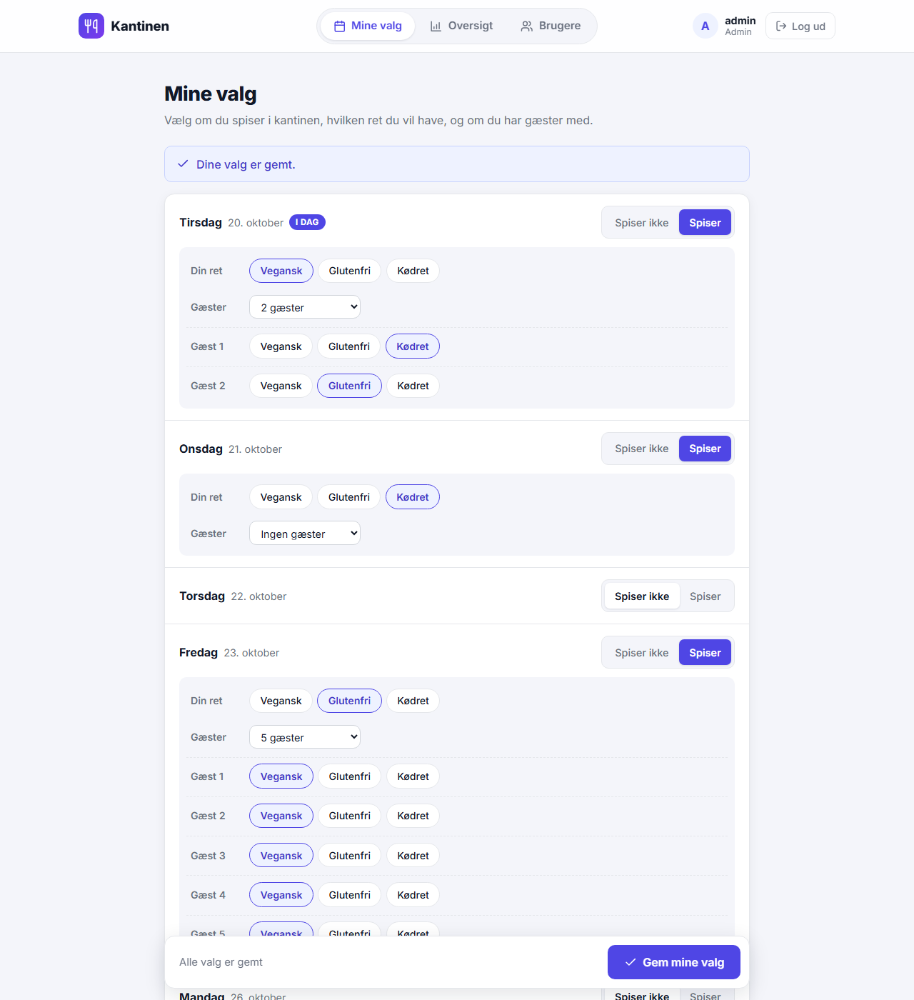
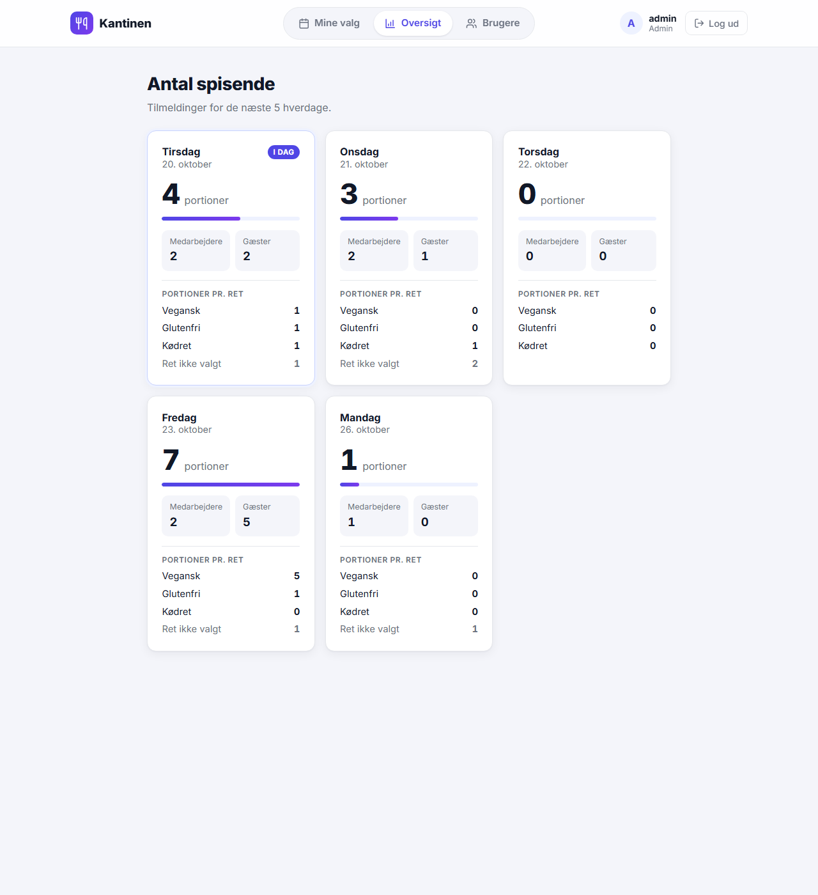
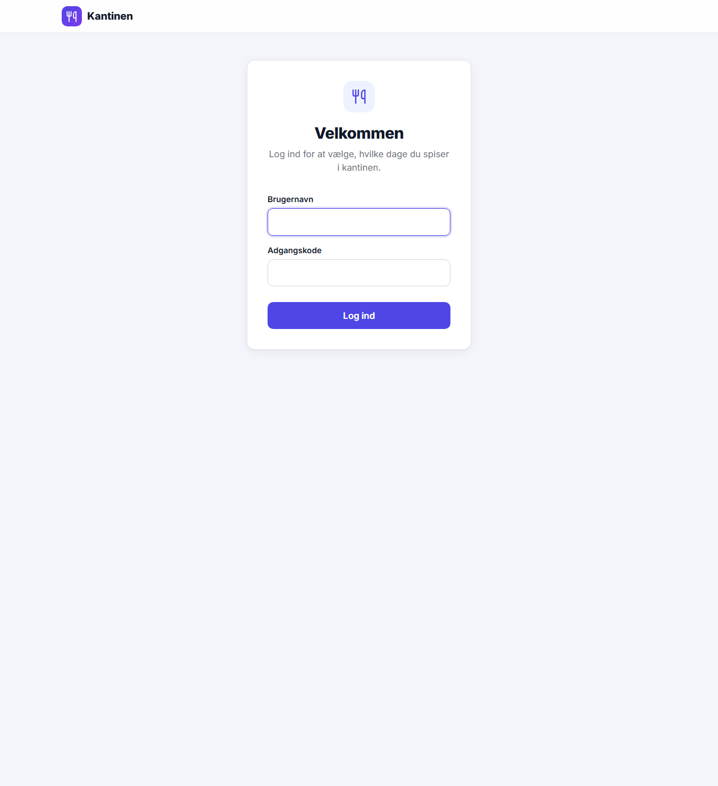
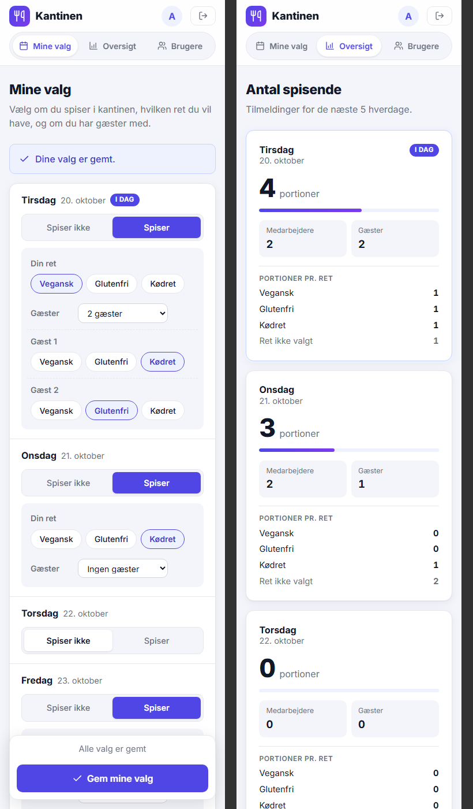

# 🍽️ Kantinen

En lille hjemmeside til en kantine. Medarbejdere logger ind og vælger for hver af de næste 5 hverdage,
om de spiser i kantinen, hvilken ret de vil have, og om de har gæster med. Kantinen kan se,
hvor mange portioner af hver ret der skal laves hver dag.

Bygget med **ASP.NET Core Razor Pages (.NET 10)** og en **SQLite**-database.



## Funktioner

| Rolle         | Kan                                                                                                      |
|---------------|----------------------------------------------------------------------------------------------------------|
| `medarbejder` | Vælge for de næste 5 hverdage: spiser / spiser ikke, egen ret (vegansk, glutenfri, kødret), 0–5 gæster med en ret pr. gæst |
| `kantine`     | Se antal medarbejdere, gæster og portioner pr. ret for hver dag                                          |
| `admin`       | Alt ovenstående + oprette og slette brugere og se/skifte deres adgangskoder                              |

- Brugere kan ikke oprette sig selv – det gør admin.
- Man kan ikke gemme sine valg, før alle personer (også gæster) har fået valgt en ret.
- Siden virker også på mobil.

| Kantinens oversigt | Login | Mobil |
|---|---|---|
|  |  |  |

## Kom i gang

Kræver [.NET 10 SDK](https://dotnet.microsoft.com/download).

```
dotnet run
```

Åbn derefter http://localhost:5138

Første gang appen starter, oprettes en tom database (`kantine.db`). Opret den første admin-bruger fra kommandolinjen:

```
dotnet run -- opret-bruger admin <adgangskode> admin
```

Log ind som admin – resten af brugerne kan oprettes på siden **Brugere**.

### Opret brugere fra kommandolinjen

```
dotnet run -- opret-bruger anna hemmeligKode medarbejder
dotnet run -- opret-bruger kok hemmeligKode kantine
```

Vil du hellere skrive direkte i databasen (fx med DB Browser for SQLite), så lav først en hash af koden og indsæt den:

```
dotnet run -- hash-kode hemmeligKode
```

```sql
INSERT INTO Brugere (Brugernavn, KodeHash, Rolle) VALUES ('anna', '<hash fra ovenfor>', 'medarbejder');
```

## Adgangskoder

Adgangskoder gemmes to gange: som hash (`KodeHash`, bruges ved login) og krypteret (`KodeKrypteret`,
så admin kan se koden på siden **Brugere**).

Krypteringsnøglen styres af ASP.NET Core Data Protection og ligger i Windows-brugerprofilen
(`%LOCALAPPDATA%\ASP.NET\DataProtection-Keys`) – ikke i projektet. Flyttes databasen til en anden computer,
kan koderne ikke længere *vises*, men de virker stadig til login, og admin kan sætte en ny kode.
Brugere oprettet med `hash-kode` + SQL vises som "Kan ikke vises", indtil koden skiftes.

## Database

| Tabel       | Kolonner                                                                                              |
|-------------|-------------------------------------------------------------------------------------------------------|
| `Brugere`   | `Id`, `Brugernavn`, `KodeHash`, `KodeKrypteret`, `Rolle`                                              |
| `Portioner` | `BrugerId`, `Dato` (yyyy-MM-dd), `Nr` (0 = medarbejderen selv, 1, 2, … = gæster), `Ret` (1 = vegansk, 2 = glutenfri, 3 = kødret) |

Der er én række pr. person, der spiser. En dag uden rækker for en medarbejder betyder "spiser ikke".
Maks antal gæster pr. dag styres af `DagsValg.MaksGaester` i `Data/Database.cs`.

Databasen er **ikke** med i repository'et (se `.gitignore`), fordi den indeholder brugere og adgangskoder.

## Projektets opbygning

```
Kantine/
├── Program.cs                  Opstart: login, sider og kommandoerne opret-bruger / hash-kode
├── Ikon.cs                     SVG-ikoner brugt på siderne
├── Kantine.csproj              Projektfil (.NET 10, SQLite-pakke)
├── appsettings.json            Indstillinger, bl.a. stien til databasen
├── Data/
│   ├── Database.cs             Al SQL: tabeller, brugere, valg og optælling
│   ├── Adgangskoder.cs         Hashing og kryptering af adgangskoder
│   └── Hverdage.cs             Udregner de næste 5 hverdage (helligdage ignoreres)
├── Pages/
│   ├── Login.cshtml(.cs)       Login
│   ├── Valg.cshtml(.cs)        Medarbejderens valg (medarbejder + admin)
│   ├── Oversigt.cshtml(.cs)    Antal spisende og portioner pr. ret (kantine + admin)
│   ├── Brugere.cshtml(.cs)     Brugeradministration (kun admin)
│   ├── Index / Logout / AdgangNaegtet / Error
│   └── Shared/
│       ├── _Layout.cshtml      Topbjælke med menu – fælles for alle sider
│       └── _RetValg.cshtml     Knapperne Vegansk / Glutenfri / Kødret
├── wwwroot/
│   ├── css/site.css            Al styling
│   └── js/valg.js              Vis/skjul ret og gæster + advarsel om ikke-gemte ændringer
└── docs/skaermbilleder/        Billederne i denne README
```
